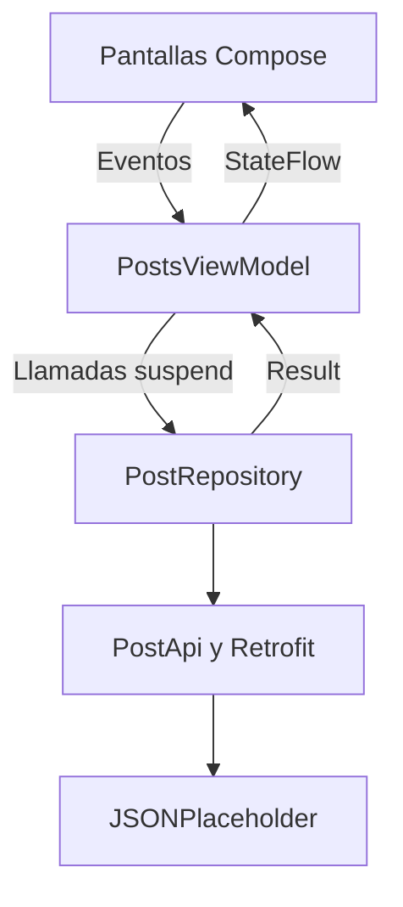

# MuroCampus

Laboratorio 09 de Programación en Móviles. La app Android consulta y publica datos de práctica en JSONPlaceholder. Permite listar publicaciones, filtrarlas por usuario, leer comentarios y enviar una publicación con título y contenido. Si falla una consulta, se muestra el error y se puede reintentar.

El proyecto se reconstruyó con ayuda de ChatGPT porque el proyecto base del curso no estaba disponible. El historial registra los cambios de esta reconstrucción.

## Ejecutar

Abre esta carpeta en Android Studio. Configura Gradle con JDK 17 y el SDK de Android 35, sincroniza y ejecuta la app en un dispositivo o emulador con Internet. En PowerShell, puedes compilar y correr las pruebas con `.\gradlew.bat :app:assembleDebug :app:testDebugUnitTest`.

## Paquetes

| Paquete | Contenido |
| --- | --- |
| `model` | Modelos serializables de publicaciones, comentarios, usuarios y creación |
| `data.remote` | Endpoints Retrofit y configuración de OkHttp |
| `data` | Contrato del repositorio, implementación remota y manejo de errores |
| `viewmodel` | Estado de la lista, el detalle y el formulario |
| `ui` | Pantallas y componentes de Jetpack Compose |
| `ui.theme` | Colores y tema |
| `MainActivity` | Montaje de dependencias y navegación |

## Evidencias en emulador

| Captura | Comprobación |
| --- | --- |
| Lista | Abrir la app y dejar cargar las publicaciones |
| Detalle | Abrir la publicación 1 y comprobar que hay cinco comentarios |
| Filtro | Elegir Usuario 2 y revisar que las publicaciones sean de ese usuario |
| Crear | Rellenar ambos campos y observar el ID 101 tras publicar |
| Sin conexión | Activar el modo avión, provocar una consulta y comprobar el botón Reintentar |

Las cinco capturas quedan pendientes hasta ejecutar la app en un emulador o dispositivo. Las pruebas unitarias usan respuestas de práctica para revisar el repositorio y la serialización.

## Para pensar

1. **GET, POST, @Query y @Body.** GET consulta un recurso. POST envía datos para que el servidor los procese. El filtro de usuario va en la URL con `@Query`. La publicación incluye título y contenido en el cuerpo JSON con `@Body`.
2. **Ruta relativa.** `posts` se resuelve debajo de la URL base de Retrofit. `/posts` empieza en la raíz del dominio y omite cualquier prefijo, como `/api/`, que aparezca en la URL base.
3. **Result en el repositorio.** El ViewModel recibe un éxito o un fallo con un mensaje que puede mostrar. El repositorio traduce los errores de Retrofit y conserva la cancelación de la corrutina.
4. **Permiso y campos nuevos.** Sin `INTERNET` Android impide que la app abra conexiones. Sin `ignoreUnknownKeys`, un campo adicional del servidor puede causar un error de deserialización. Un campo obligatorio ausente sigue siendo un error.
5. **Estado único.** `UiState` representa carga, éxito o error de forma exclusiva. El `when` obliga a definir qué dibujar para cada estado y evita combinaciones contradictorias entre indicadores.
6. **Servidor real.** El POST guardaría la publicación y devolvería su ID. La app podría mostrar el resultado en su lista al agregar la respuesta recibida o recargar las publicaciones. JSONPlaceholder simula el cambio y la lista remota vuelve a mostrar los datos originales.
