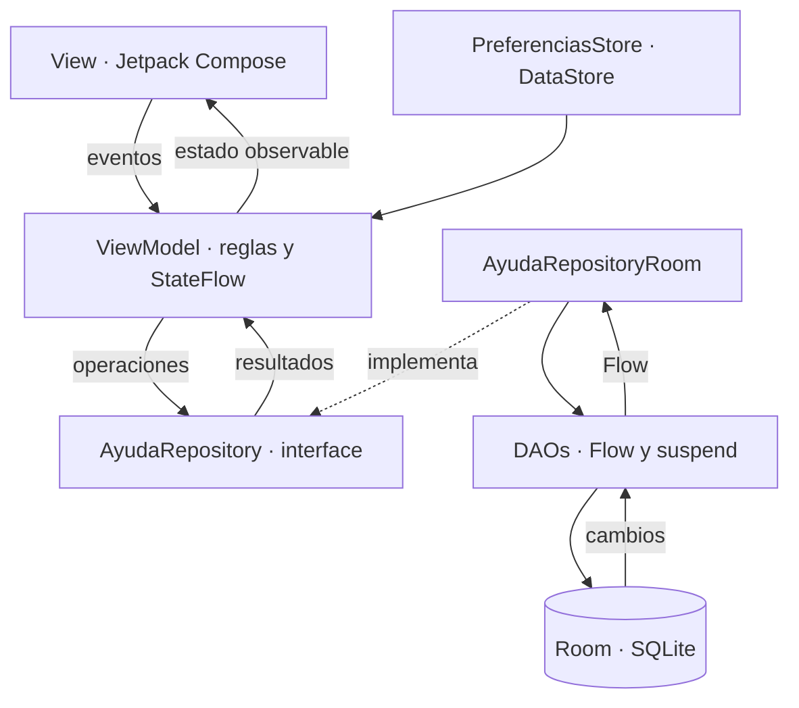

# AyudaCampus

**Estudiante:** Diego Magallanes Linares · C24-B  
**Curso:** Programación en Móviles · Laboratorio 08  
**Alcance:** Fase 1, aplicación local de mesa de ayuda TI con perfiles Estudiante y Soporte.

Implementación creada desde cero a partir de la estructura y los contratos del laboratorio. No se recibió un proyecto base. El primer commit incorpora la infraestructura y el ejemplo funcional de categorías; los siguientes corresponden a los pasos de la guía.

## Abrir y ejecutar

1. Abre esta carpeta (`Semana-08/AyudaCampus`) con **File → Open** en Android Studio.
2. Selecciona JDK 17 o superior para Gradle e instala Android SDK 35.
3. Sincroniza Gradle y ejecuta `app` en Android 7.0 (API 24) o superior.
4. Los datos ficticios se crean una sola vez, dentro de una transacción.

| Perfil | Correo | Contraseña |
| --- | --- | --- |
| Estudiante | juan@campus.test | 1234 |
| Soporte TI | soporte@campus.test | admin |

Ambos perfiles comparten **la base Room de este dispositivo**. El botón de cambio de perfil es para practicar y selecciona también la cuenta correspondiente. La aplicación no se conecta a un servidor. Las credenciales de demostración se guardan como indica el laboratorio; solo se deben usar datos ficticios.

## Funcionalidades

- Login con validación de credenciales y rol, restauración de sesión y cierre de sesión.
- Tickets propios del estudiante, búsqueda por título/número y filtros por estado.
- Formulario con categorías activas y validaciones por campo; prioridad MEDIA por defecto.
- Conversación reactiva, seguimiento de cuatro estados, cierre con 1–5 estrellas y reapertura de tickets resueltos.
- Bandeja de soporte ordenada por prioridad ALTA → MEDIA → BAJA y luego por fecha descendente.
- Panel con conteos, dona por estado, barras por categoría y alertas de ALTA abiertas hace más de una hora. El límite temporal se actualiza cada 30 segundos.
- Creación, edición, activación y eliminación de categorías; se impide eliminar categorías que tienen tickets.
- Perfil con resumen, ajustes y persistencia de modo oscuro, notificaciones y recepción de tickets. El switch de notificaciones guarda la preferencia; no se implementan notificaciones push.
- Si Soporte desactiva la recepción de tickets, el estudiante ve “Mesa de ayuda cerrada” y el ViewModel impide enviar.

## Arquitectura



`NavAyuda` es el punto de composición e inyección: crea ViewModels mediante la factoría. Las pantallas reciben ViewModels y callbacks, nunca consultan DAOs ni el Repository. Los ViewModels acceden a la interface `AyudaRepository`; solo su implementación conoce Room. DataStore se limita a preferencias.

```text
com.tecsup.ayudacampus/
├── MainActivity.kt
├── AyudaApp.kt
├── data/
│   ├── local/
│   │   ├── entity/       Categoria, Usuario, Ticket, Comentario
│   │   ├── dao/          CategoriaDao, UsuarioDao, TicketDao
│   │   ├── relation/     TicketConDetalle
│   │   ├── AyudaDatabase.kt
│   │   └── DatosIniciales.kt
│   ├── repository/       AyudaRepository, AyudaRepositoryRoom
│   └── prefs/            PreferenciasStore
├── model/                Rol, EstadoTicket, Prioridad, ConteoCategoria, DatoGrafico
├── viewmodel/            Sesion, MisTickets, NuevoTicket, TicketDetalle,
│                         Panel, Bandeja, Atender, Categorias, Perfil y factoría
└── ui/
    ├── theme/            AyudaTheme(rol, oscuro), paleta centralizada
    ├── components/       Campos, botones, chips, tarjetas, conversación,
    │   └── graficos/     Dona y barras (stepper y estrellas en components/)
    ├── navigation/       Rutas, NavAyuda
    ├── cliente/          Splash, Login, MisTickets, Nuevo, Detalle, Perfil
    └── soporte/          Panel, Bandeja, Atender, Categorías, Formulario, Ajustes
```

Room contiene cuatro tablas con claves foráneas e índices. `TicketConDetalle` reúne ticket, cliente, categoría y comentarios mediante `@Relation`; sus lecturas usan `@Transaction`. Las operaciones que modifican datos son `suspend`. El esquema 2 incluye una migración desde el ejemplo inicial de categorías, sin destruir datos.

## Diseño

`AyudaTheme(rol, oscuro)` selecciona Cian `#0891B2` para Estudiante y Violeta `#7C3AED` para Soporte. Las pantallas toman sus colores de `MaterialTheme`; los colores semánticos de estado y prioridad se centralizan en el tema. El flag de modo oscuro procede de DataStore y se aplica a toda la app.

| Estudiante: tickets | Estudiante: nuevo | Estudiante: detalle |
| --- | --- | --- |
|  |  |  |

| Soporte: panel | Soporte: bandeja | Soporte: atención |
| --- | --- | --- |
|  |  |  |

## Verificación final

Compilación debug correcta y 5 pruebas instrumentadas aprobadas en el emulador: 3 de datos y reglas, 1 de recorrido completo y 1 de restauración tras reiniciar el proceso. Se incluyen seis capturas reales. Lint quedó pendiente por una descarga.

```bash
./gradlew :app:assembleDebug
./gradlew :app:connectedDebugAndroidTest \
  -Pandroid.testInstrumentationRunnerArguments.class=com.tecsup.ayudacampus.DatosYReglasTest,com.tecsup.ayudacampus.FlujoCompletoTest
./gradlew :app:connectedDebugAndroidTest \
  -Pandroid.testInstrumentationRunnerArguments.class=com.tecsup.ayudacampus.RestauracionTest
```

Las pruebas de datos usan una base Room en memoria independiente de la base de la app. `FlujoCompletoTest` necesita una instalación de pruebas con los datos iniciales y sin sesión; crea el ticket 7 y deja la sesión y el modo oscuro guardados. `RestauracionTest` debe ejecutarse después, en una instrumentación nueva y sin borrar datos: comprueba la persistencia y deja el tema claro para la presentación. Para repetir el recorrido desde cero, borra únicamente los datos de la app en un emulador de pruebas dedicado.

Consulta [la matriz de aceptación](docs/ACEPTACION.md) para ver los resultados y su alcance.

## Para pensar

1. Las reglas van en el ViewModel para aplicarlas sin depender de cómo se dibuja la pantalla ni de cómo se guardan los datos.
2. `crearTicket` es `suspend` porque hace una escritura puntual; `observarTicket` devuelve `Flow` para emitir los cambios posteriores.
3. Cerrar sin calificación dejaría incompleta la evaluación obligatoria de la atención y permitiría saltarse la regla del negocio.
4. Para usar un servidor cambiaría la implementación del Repository y su inyección; mantendría el contrato y los ViewModels y pantallas.

## Git

La Fase 1 se registra en 14 commits con los mensajes de la guía, desde la carpeta de este proyecto y sobre `main`. No se ha iniciado la Fase 2. Al ser parte de un repositorio de curso, el historial general también contiene commits anteriores de otros laboratorios.
