# AyudaCampus

**Estudiante:** Diego Magallanes · C24-B<br>
**Curso:** Programación en Móviles · Laboratorio 08  
**Alcance:** aplicación local de mesa de ayuda TI con perfiles Estudiante y Soporte; Fase 1 y tres mejoras funcionales de Fase 2.

Implementación creada desde cero a partir de la estructura y los contratos del laboratorio. No se recibió un proyecto base. El primer commit incorpora la infraestructura y el ejemplo funcional de categorías; los siguientes corresponden a los pasos de la guía.

## Abrir y ejecutar

1. Abre esta carpeta (`Semana-08/AyudaCampus`) con **File → Open** en Android Studio.
2. Selecciona JDK 17 o superior para Gradle e instala Android SDK 35.
3. Sincroniza Gradle y ejecuta `app` en Android 7.0 (API 24) o superior.
4. Los datos ficticios se crean una sola vez, dentro de una transacción.

| Perfil | Correo | Contraseña |
| --- | --- | --- |
| Estudiante | juan@campus.test | 1234 |
| Soporte TI | soporte@campus.test | admin |

Ambos perfiles comparten **la base Room de este dispositivo**. El botón de cambio de perfil es para practicar y selecciona también la cuenta correspondiente. La aplicación no se conecta a un servidor. Las credenciales de demostración se guardan como indica el laboratorio; solo se deben usar datos ficticios.

## Funcionalidades

- Login con validación de credenciales y rol, restauración de sesión y cierre de sesión.
- Tickets propios del estudiante, búsqueda por título/número y filtros por estado.
- Formulario con categorías activas y validaciones por campo; prioridad MEDIA por defecto.
- Conversación reactiva, seguimiento de cuatro estados, cierre con 1–5 estrellas y reapertura de tickets resueltos.
- Bandeja de soporte ordenada por prioridad ALTA → MEDIA → BAJA y luego por fecha descendente.
- Panel con conteos, dona por estado, barras por categoría y alertas de ALTA abiertas hace más de una hora. El límite temporal se actualiza cada 30 segundos.
- Creación, edición, activación y eliminación de categorías; se impide eliminar categorías que tienen tickets.
- Perfil con resumen, ajustes y persistencia de modo oscuro, notificaciones y recepción de tickets. El switch de notificaciones guarda la preferencia; no se implementan notificaciones push.
- Si Soporte desactiva la recepción de tickets, el estudiante ve “Mesa de ayuda cerrada” y el ViewModel impide enviar.

## Arquitectura

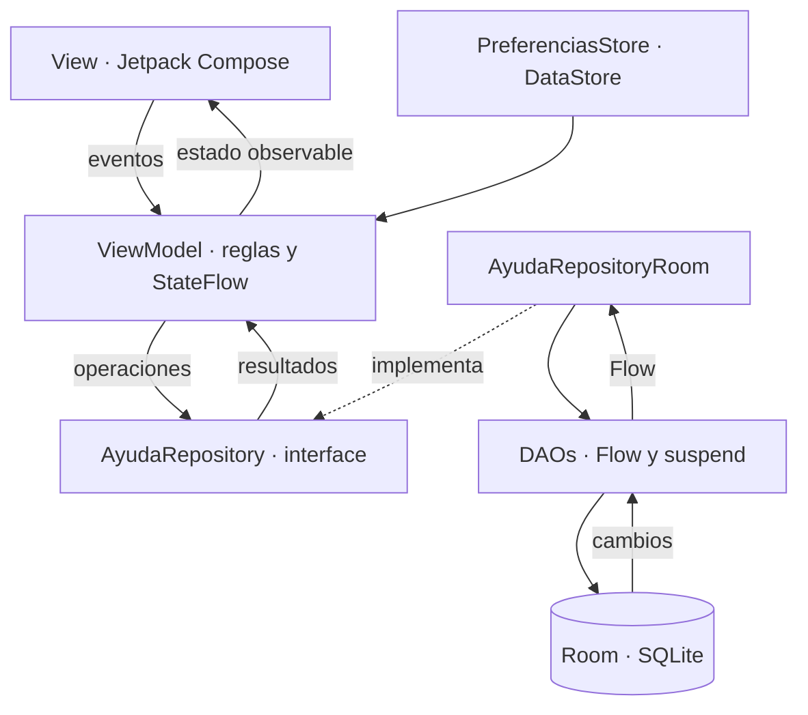

`NavAyuda` es el punto de composición e inyección: crea ViewModels mediante la factoría. Las pantallas reciben ViewModels y callbacks, nunca consultan DAOs ni el Repository. Los ViewModels acceden a la interface `AyudaRepository`; solo su implementación conoce Room. DataStore se limita a preferencias.

```text
com.tecsup.ayudacampus/
├── MainActivity.kt
├── AyudaApp.kt
├── data/
│   ├── local/
│   │   ├── entity/       Categoria, Usuario, Ticket, Comentario
│   │   ├── dao/          CategoriaDao, UsuarioDao, TicketDao
│   │   ├── relation/     TicketConDetalle
│   │   ├── AyudaDatabase.kt
│   │   └── DatosIniciales.kt
│   ├── repository/       AyudaRepository, AyudaRepositoryRoom
│   └── prefs/            PreferenciasStore
├── model/                Rol, EstadoTicket, Prioridad, ConteoCategoria, DatoGrafico
├── viewmodel/            Sesion, MisTickets, NuevoTicket, TicketDetalle,
│                         Panel, Bandeja, Atender, Categorias, Perfil y factoría
└── ui/
    ├── theme/            AyudaTheme(rol, oscuro), paleta centralizada
    ├── components/       Campos, botones, chips, tarjetas, conversación,
    │   └── graficos/     Dona y barras (stepper y estrellas en components/)
    ├── navigation/       Rutas, NavAyuda
    ├── cliente/          Splash, Login, MisTickets, Nuevo, Detalle, Perfil
    └── soporte/          Panel, Bandeja, Atender, Categorías, Formulario, Ajustes
```

Room contiene cuatro tablas con claves foráneas e índices. `TicketConDetalle` reúne ticket, cliente, categoría y comentarios mediante `@Relation`; sus lecturas usan `@Transaction`. Las operaciones que modifican datos son `suspend`. El esquema 2 incluye una migración desde el ejemplo inicial de categorías, sin destruir datos.

## Diseño

`AyudaTheme(rol, oscuro)` selecciona Cian `#0891B2` para Estudiante y Violeta `#7C3AED` para Soporte. Las pantallas toman sus colores de `MaterialTheme`; los colores semánticos de estado y prioridad se centralizan en el tema. El flag de modo oscuro procede de DataStore y se aplica a toda la app.

| Estudiante: tickets | Estudiante: nuevo | Estudiante: detalle |
| --- | --- | --- |
| 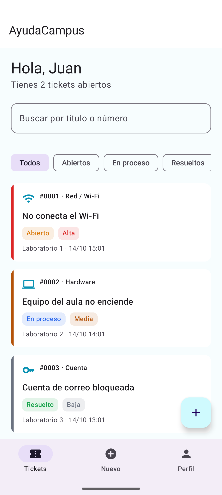 | 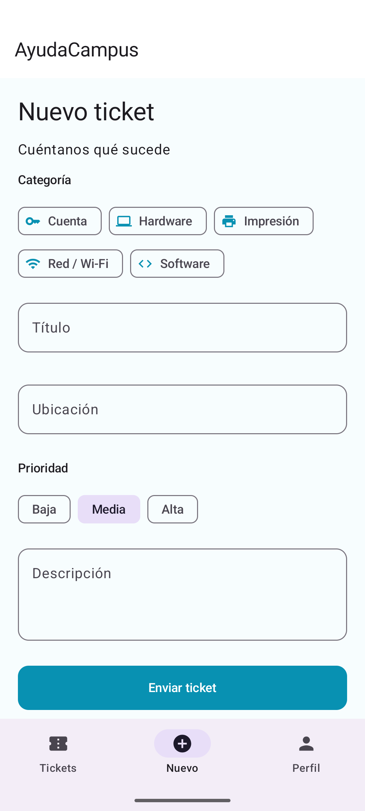 | 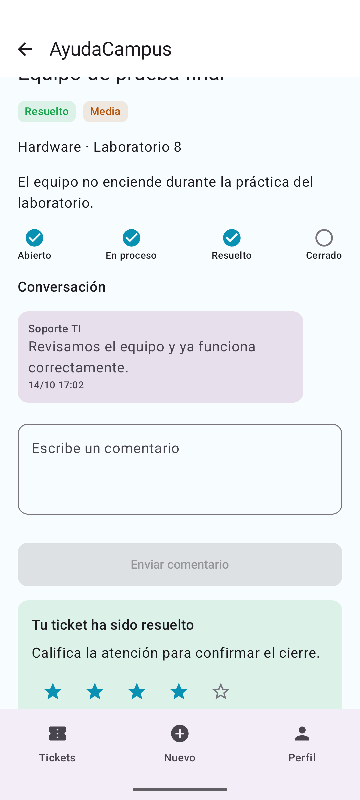 |

| Soporte: panel | Soporte: bandeja | Soporte: atención |
| --- | --- | --- |
| 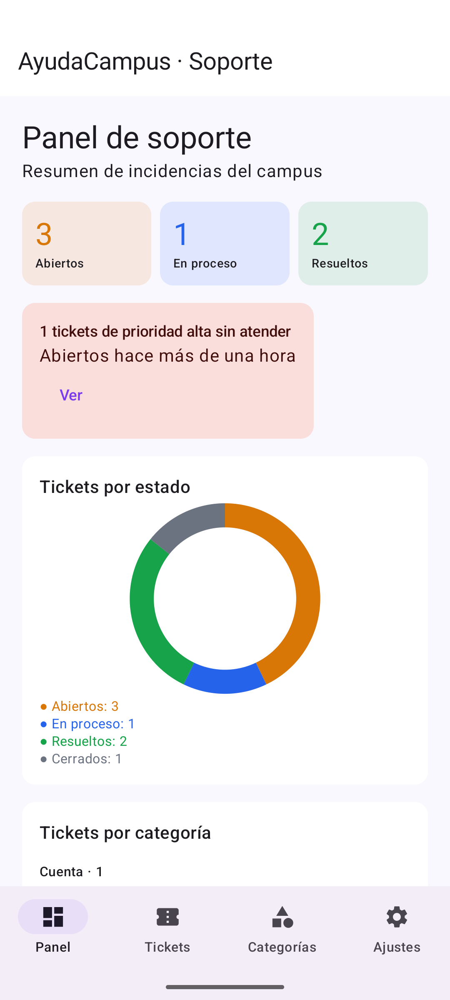 | 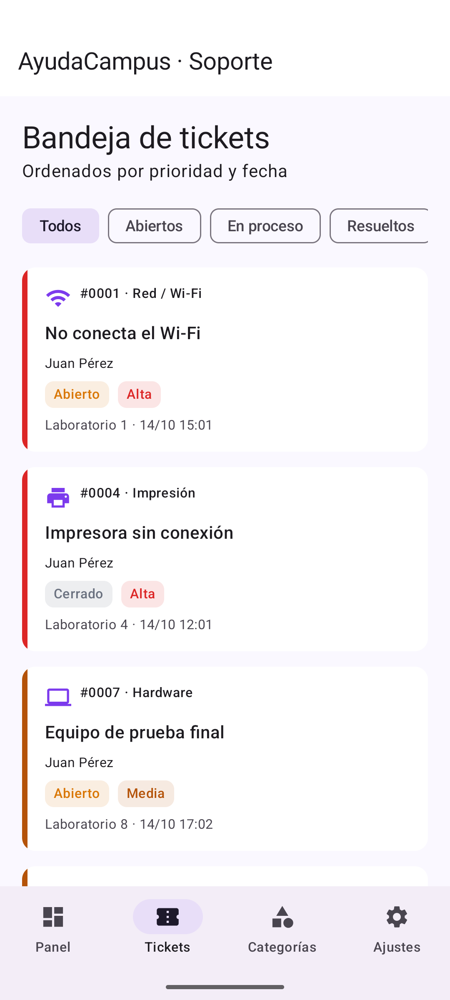 | 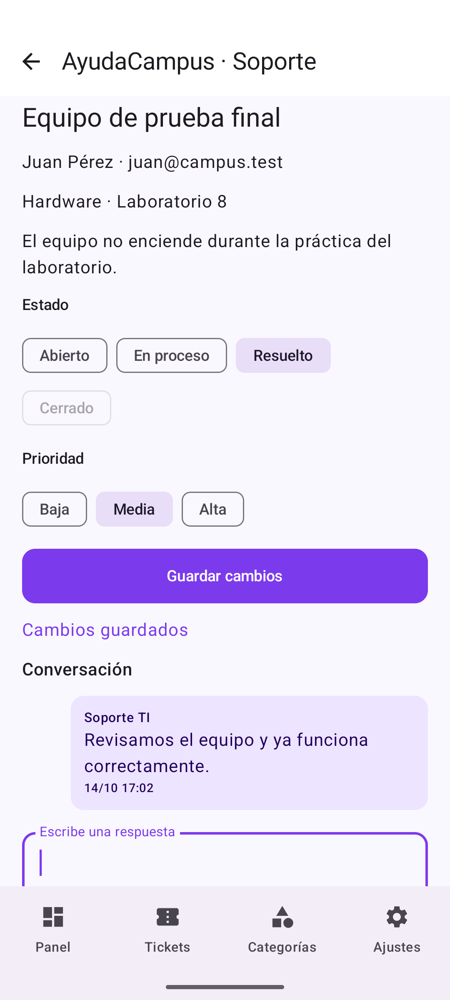 |

## Verificación final

Compilación debug correcta y 5 pruebas instrumentadas aprobadas en el emulador: 3 de datos y reglas, 1 de recorrido completo y 1 de restauración tras reiniciar el proceso. Se incluyen seis capturas reales. Lint quedó pendiente por una descarga.

```bash
./gradlew :app:assembleDebug
./gradlew :app:connectedDebugAndroidTest \
  -Pandroid.testInstrumentationRunnerArguments.class=com.tecsup.ayudacampus.DatosYReglasTest,com.tecsup.ayudacampus.FlujoCompletoTest
./gradlew :app:connectedDebugAndroidTest \
  -Pandroid.testInstrumentationRunnerArguments.class=com.tecsup.ayudacampus.RestauracionTest
```

Las pruebas de datos usan una base Room en memoria independiente de la base de la app. `FlujoCompletoTest` necesita una instalación de pruebas con los datos iniciales y sin sesión; crea el ticket 7 y deja la sesión y el modo oscuro guardados. `RestauracionTest` debe ejecutarse después, en una instrumentación nueva y sin borrar datos: comprueba la persistencia y deja el tema claro para la presentación. Para repetir el recorrido desde cero, borra únicamente los datos de la app en un emulador de pruebas dedicado.

Consulta [la matriz de aceptación](docs/ACEPTACION.md) para ver los resultados y su alcance.

## Para pensar

1. Las reglas van en el ViewModel para aplicarlas sin depender de cómo se dibuja la pantalla ni de cómo se guardan los datos.
2. `crearTicket` es `suspend` porque hace una escritura puntual; `observarTicket` devuelve `Flow` para emitir los cambios posteriores.
3. Cerrar sin calificación dejaría incompleta la evaluación obligatoria de la atención y permitiría saltarse la regla del negocio.
4. Para usar un servidor cambiaría la implementación del Repository y su inyección; mantendría el contrato y los ViewModels y pantallas.

## Git

La Fase 1 se registra en 14 commits con los mensajes de la guía, desde la carpeta de este proyecto y sobre `main`. Ese fue el estado al cerrar la Fase 1; la Fase 2 se documenta a continuación. Al ser parte de un repositorio de curso, el historial general también contiene commits anteriores de otros laboratorios.


## Fase 2 — promedio, SLA y búsqueda avanzada

Rama: [mejora-ia-ayudacampus](https://github.com/DiegoMagallanes11/Programacion-en-Moviles/tree/mejora-ia-ayudacampus/Semana-08/AyudaCampus). El usuario autorizó este nombre porque la rama antigua `mejora-ia` contiene trabajo de otro laboratorio y diverge de `main`. Se conserva intacta. La nueva rama parte de `ac4e370`; los catorce commits de Fase 1 permanecen en `main`. Se trabaja en una copia aislada para preservar los cambios locales de otros laboratorios.

### Tiempo promedio de resolución

El panel observa `AVG(fechaCierre - fecha)` mediante DAO → Repository → ViewModel → View. Solo entran tickets `CERRADO` con cierre no nulo y mayor o igual que su creación. **Mide desde la creación hasta el cierre confirmado por el estudiante**, no hasta que Soporte marca RESUELTO. Room actualiza el valor por Flow al cerrar un ticket. La ausencia de datos muestra «Sin tickets cerrados»; un promedio válido de cero muestra «Menos de 1 min». Se conservan los conteos, gráficos y la alerta anterior.

### Contador de SLA

| Prioridad actual | Presupuesto desde la creación original |
| --- | --- |
| ALTA | 4 horas |
| MEDIA | 24 horas |
| BAJA | 72 horas |

El límite es `fecha + presupuesto`; el restante es `límite - ahora`, con duraciones `Long`. Para ABIERTO y EN_PROCESO, un restante positivo muestra «SLA: … restantes»; cero o negativo muestra «SLA vencido hace …». Para RESUELTO y CERRADO se muestra «SLA: ticket resuelto/cerrado», sin inventar una hora histórica de resolución. Cambiar prioridad usa la fecha original y el presupuesto de la nueva prioridad. Reabrir conserva la fecha original y no reinicia el plazo.

El cálculo puro recibe la hora actual. Cada pantalla tiene un solo reloj observable de 30 segundos, compartido por sus tarjetas, ligado a `viewModelScope` y detenido sin suscriptores. Las Views recogen el estado de SLA con el ciclo de vida. No se almacena un contador en Room ni DataStore. El SLA aparece en Mis tickets, bandeja, detalle de estudiante y atención de soporte; texto y colores del tema distinguen activo, vencido y finalizado.

### Búsqueda avanzada

Estado, texto, prioridad y categoría se combinan con **AND** en `BandejaViewModel`. El texto busca en título, descripción o ID, ignora mayúsculas y espacios exteriores, y admite `8`, `#8` y `#0008`. El número se interpreta como ID completo. Un texto vacío no restringe resultados.

Las categorías se seleccionan por ID e incluyen las inactivas con datos históricos. Si desaparece la seleccionada, vuelve a Todas. El formulario de creación mantiene únicamente categorías activas. El filtrado conserva el orden de Room: ALTA → MEDIA → BAJA, luego fecha e ID descendentes. Los cambios de datos actualizan resultados sin tocar controles. La pantalla muestra la cantidad, «Limpiar filtros», un mensaje de ausencia de coincidencias y otro distinto para una bandeja vacía. Los filtros permanecen al abrir y volver de un ticket. Los controles se desplazan con teclado abierto y las prioridades se distribuyen en varias filas en pantallas pequeñas.

No se cambiaron dependencias, entidades, versión de Room, factoría ni reglas anteriores de estados. Las cuentas y la base local compartida se mantienen.

### Capturas reales de Fase 2

| Promedio en el panel | SLA en Mis tickets |
| --- | --- |
| 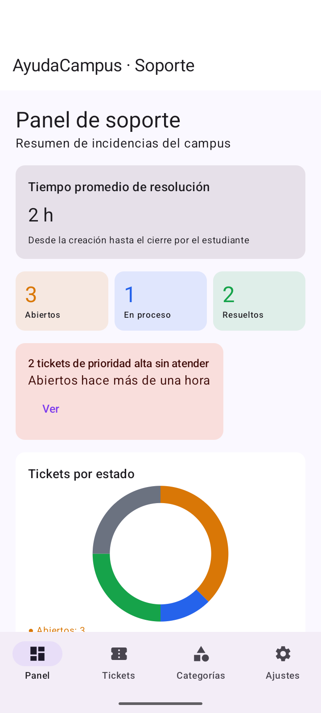 | 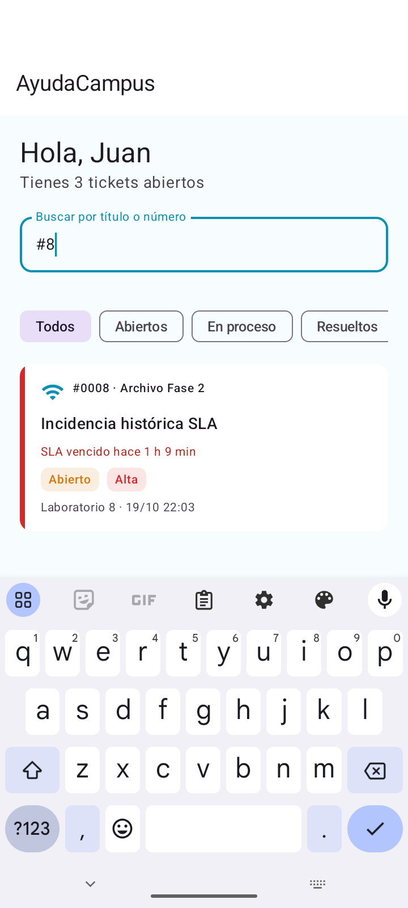 |

| SLA en detalle | SLA en atención |
| --- | --- |
| 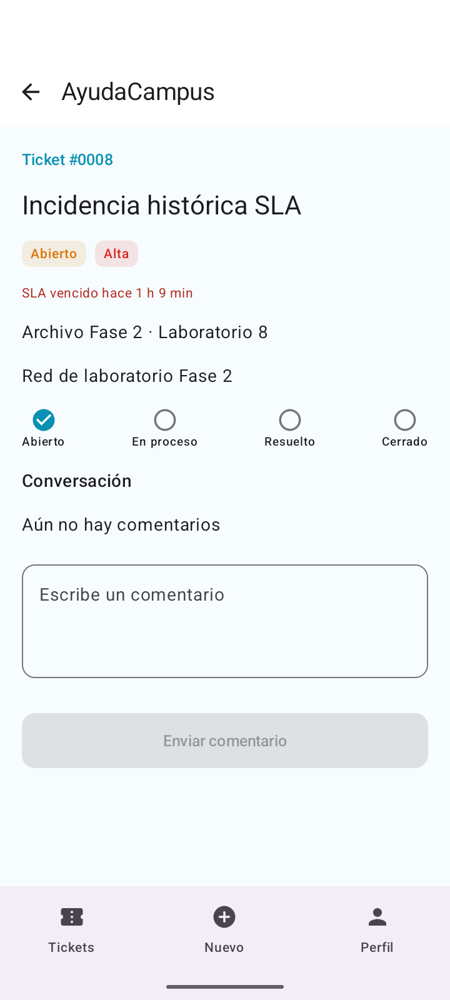 | 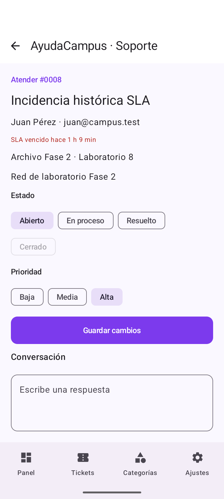 |

| Filtros combinados y categoría histórica | Sin coincidencias tras cambiar los datos |
| --- | --- |
| 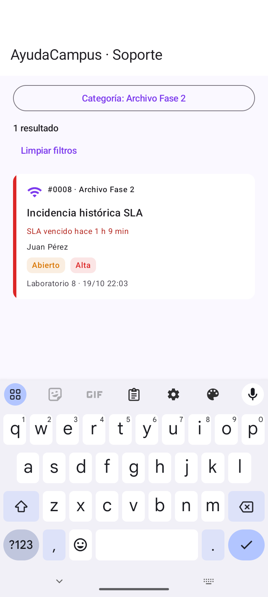 | 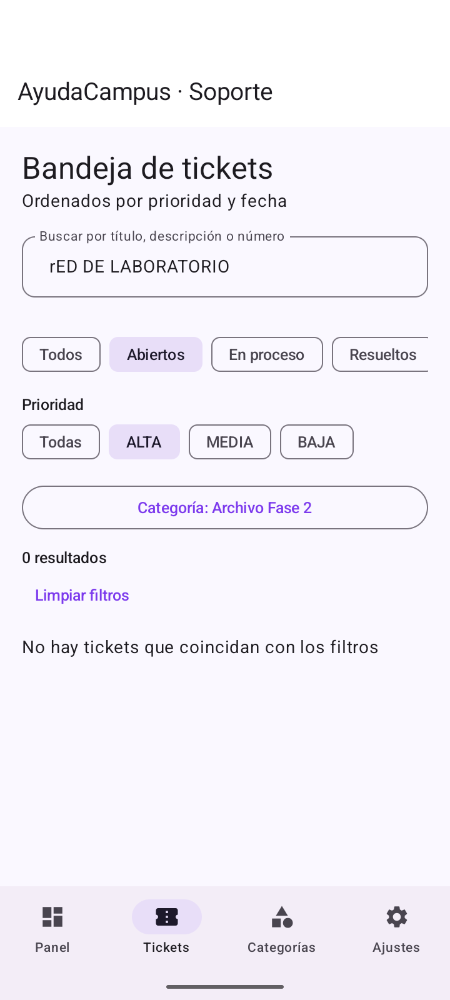 |

### Verificaciones nuevas y reproducción

Entorno de esta ejecución: Windows, JDK 21, SDK 35 y emulador independiente `AyudaCampusFase2`, Pixel 7, Android 15/API 35, x86_64. No se borraron datos de la instalación de presentación. El JBR predeterminado de Android Studio era Java 25 e incompatible con este Gradle/Kotlin; se usó el JDK 21 ya instalado.

Desde esta carpeta, con JDK 21 y Android SDK configurados:

```powershell
.\gradlew.bat :app:assembleDebug :app:testDebugUnitTest :app:assembleDebugAndroidTest :app:lintDebug
```

Las pruebas de promedio y SLA usan tiempos controlados; las de búsqueda comprueban filtros, orden y reactividad. Los dos casos de `PromedioRoomTest` usan una base Room en memoria y no modifican la base del usuario.

Para la prueba integrada, usar un **AVD dedicado nuevo**, con los datos iniciales y sesión cerrada. El ejemplo apunta explícitamente al dispositivo de esta ejecución para no seleccionar la instalación de presentación:

```powershell
$adb = "$env:LOCALAPPDATA\Android\Sdk\platform-tools\adb.exe"
& $adb -s emulator-5560 install -r app/build/outputs/apk/debug/app-debug.apk
& $adb -s emulator-5560 install -r app/build/outputs/apk/androidTest/debug/app-debug-androidTest.apk
& $adb -s emulator-5560 shell am instrument -w -r -e class com.tecsup.ayudacampus.DatosYReglasTest,com.tecsup.ayudacampus.PromedioRoomTest,com.tecsup.ayudacampus.FlujoCompletoTest com.tecsup.ayudacampus.test/androidx.test.runner.AndroidJUnitRunner
& $adb -s emulator-5560 shell am force-stop com.tecsup.ayudacampus
& $adb -s emulator-5560 shell am instrument -w -r -e class com.tecsup.ayudacampus.RestauracionTest com.tecsup.ayudacampus.test/androidx.test.runner.AndroidJUnitRunner
& $adb -s emulator-5560 shell am instrument -w -r -e class com.tecsup.ayudacampus.BusquedaUiTest com.tecsup.ayudacampus.test/androidx.test.runner.AndroidJUnitRunner
```

`RestauracionTest` necesita el estado dejado por `FlujoCompletoTest` y una instrumentación nueva, sin borrar datos. `BusquedaUiTest` se ejecuta después: agrega una categoría inactiva y un ticket ALTA creado cinco horas antes, comprueba búsqueda combinada, teclado abierto, regreso del detalle, cambios de datos con filtros activos y número con/sin #. Guarda las capturas en `files/capturas/fase-2/` de la app del emulador. Para repetir todo, usar otro AVD de pruebas nuevo; no reutilizar como estado inicial el que ya pasó por estos recorridos.

### Resultados y límites

- Compilación debug y APK de instrumentación: correctos.
- Pruebas unitarias: **10 casos aprobados en total** (2 promedio, 5 SLA, 3 búsqueda). El 20 de octubre se ejecutaron las 5 de SLA, incluida la nueva contribución de Gemini; las otras 5 conservan los resultados del 19 de octubre.
- Pruebas instrumentadas: **8 aprobadas** (3 datos/reglas, 2 promedio Room, 1 recorrido completo, 1 restauración y 1 búsqueda UI). **Seis capturas reales** de Fase 2; detalles e incidencias en [la matriz de aceptación](docs/ACEPTACION.md).
- `lintDebug`: terminó sin errores y con **17 advertencias**. Tres avisos indican comprobaciones personalizadas de Navigation omitidas por incompatibilidad con la versión de lint. También hay avisos de versiones de dependencias, target API, reglas de extracción e icono; no se actualizaron dependencias para resolverlos. Esto no convierte el lint pendiente de Fase 1 en una ejecución aprobada de aquella fase.
- **Participación real de Gemini, 20 de octubre:** Gemini 3.6 Flash en Android Studio generó y corrigió una prueba de regresión del SLA con fechas grandes. Codex la integró y ejecutó: 5 pruebas de SLA aprobadas. Las tres mejoras funcionales fueron implementadas previamente con Codex; ese trabajo no se reatribuye a Gemini. Véanse los prompts 5 y 6 de [PROMPTS.md](PROMPTS.md) y [las respuestas y capturas reales](docs/gemini/RESPUESTAS.md).

Registro de solicitudes, herramienta real, correcciones y reflexión: [PROMPTS.md](PROMPTS.md). La matriz conserva intactos los resultados anteriores y agrega las verificaciones de Fase 2 con su alcance real.


### Aporte posterior de Gemini

La prueba `fechasGrandesYCambioDePrioridadConservanElPlazoOriginal` verifica el cálculo con una fecha próxima a `Int.MAX_VALUE` y con `1_800_000_000_000L`. A las cinco horas desde la creación, ALTA debe llevar una hora vencida; al cambiar a BAJA, conservando fecha y hora actual, deben quedar 67 horas. La respuesta inicial de Gemini no comprobaba el estado ALTA previo: Codex solicitó corregirlo y usar expectativas literales independientes. El método corregido pasó junto a las otras cuatro pruebas de SLA.

```powershell
.\gradlew.bat :app:testDebugUnitTest --tests com.tecsup.ayudacampus.SlaTest
```

Este aporte se guarda en un commit adicional porque los cuatro commits iniciales ya estaban publicados y se conservan sin reescribir. Las capturas de la app y los resultados instrumentados anteriores permanecen intactos. La contribución de Gemini corresponde a verificación del SLA, no a la autoría de las tres implementaciones originales.


## Revisión de navegación y perfil

La cuenta de práctica muestra **Diego Magallanes**. Conserva el correo de acceso juan@campus.test y la contraseña de demostración; una actualización idempotente cambia el nombre anterior sin borrar tickets, conversaciones ni preferencias. El perfil presenta los cuatro estados y el total de tickets.

La barra inferior guarda y restaura las pestañas, evita duplicar el destino activo y cierra el teclado al cambiar de opción. El formulario consume la confirmación de envío para poder volver a Nuevo. Las capturas históricas se conservan; las nuevas muestran la personalización.

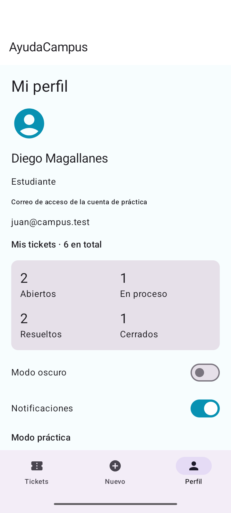
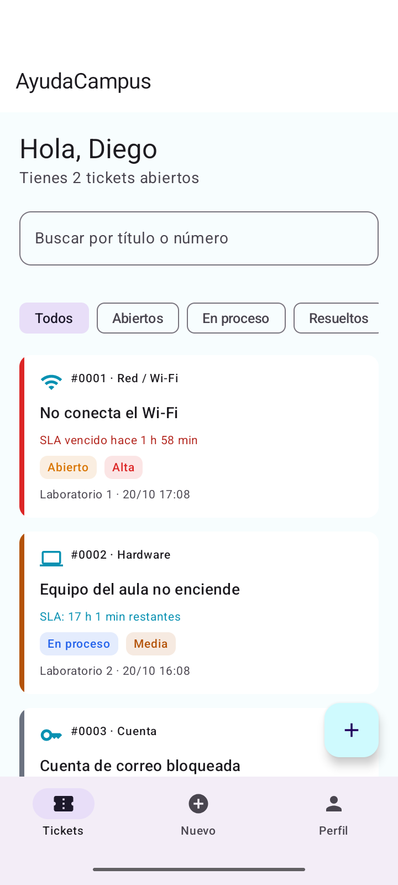

Consulta [el contraste con la rúbrica, observaciones y conclusiones](docs/RUBRICA.md). No se garantiza una nota ni se acredita puntualidad sin conocer la fecha de entrega.

Comprobación nueva: NavegacionPerfilTest requiere que estén disponibles los perfiles ficticios; acepta una sesión existente, cambia de pestañas y de rol, conserva un borrador, no crea tickets y termina en Estudiante. DatosYReglasTest incluye una prueba Room en memoria que simula la cuenta antigua y comprueba que se conservan tickets y mensajes. El 20 de octubre pasaron las 10 unitarias y las 5 instrumentadas focalizadas. No se repitieron el recorrido completo ni lint en esta revisión.


## Auditoría final de Fase 2

La Fase 1 se conserva terminada en main. La [auditoría completa](docs/AUDITORIA.md) contrasta los contratos de las 26 páginas de la guía con la app y sus pruebas. Resultado final: **12 unitarias y 10 instrumentadas distintas aprobadas**, debug e instrumentación compilados, lint sin errores y con 17 advertencias. Los tres checks personalizados de Navigation omitidos no se dan por ejecutados.

Se corrigieron la búsqueda del número visible del estudiante y el mensaje de carga del promedio. La personalización conserva los nombres históricos de comentarios: los mensajes nuevos usan Diego y los anteriores mantienen su foto del momento. Las nuevas evidencias están en [capturas/auditoria](docs/capturas/auditoria/) y los [registros de pruebas](docs/resultados/auditoria/pruebas.txt).

Para repetir el recorrido completo se necesita una instalación de pruebas nueva con sesión cerrada y seis tickets iniciales. Ejecuta DatosYReglasTest, PromedioRoomTest y FlujoCompletoTest; después detén el proceso y ejecuta RestauracionTest en otra instrumentación **sin borrar datos**. Luego pueden ejecutarse NavegacionPerfilTest y BusquedaUiTest. No uses la instalación de presentación para restablecer precondiciones. La revisión posterior del promedio repitió solo las comprobaciones afectadas.

La implementación y esta auditoría se atribuyen a Codex. El aporte real de Gemini en Android Studio fue la prueba de SLA documentada; se mantiene esa distinción y no se garantiza una calificación académica.

### Revisión de Perfil y controles

Perfil muestra los datos del estudiante, total y cuatro estados de sus tickets. Los ajustes responden al pulsar toda su fila. Notificaciones guarda la preferencia; esta versión local no envía avisos del sistema. Volver desde un detalle cierra el teclado. ControlesPerfilTest agregó un caso aprobado (28.913 s) para preferencias, mesa cerrada, roles, teclado y sesión; la compilación y lint pasaron. Las pruebas anteriores se conservan como resultados de su ejecución, sin repetir toda la suite. Ver [evidencias y alcance](docs/ACEPTACION.md#controles-de-perfil-y-ajustes-20-de-octubre-de-2026).

Para repetir solo esta revisión, con los dos perfiles ficticios y al menos un ticket abierto del estudiante, ejecuta `ControlesPerfilTest` desde Android Studio. No crea tickets ni modifica conversaciones. Restaura las preferencias y termina con sesión de Estudiante. Evita interactuar con la app durante la instrumentación.

### Correcciones del 21 de octubre

La barra ya no restaura un detalle antiguo al cambiar desde Nuevo a Tickets: cada opción abre la raíz de su pestaña y mantiene su selección visual. Se conserva el borrador de Nuevo. Además, los comentarios y respuestas se limpian solo cuando se confirma el guardado; un error conserva el texto para reintentar.

`BarraInferiorTest` aprobó un caso nuevo de navegación repetida en ambos roles; `EnvioComentarioUiTest` aprobó dos casos de error y reintento sobre Repository simulado, sin escribir en la base de presentación. Debug, APK de pruebas y lint compilaron correctamente (0 errores y 17 advertencias). Ver [resultados reales](docs/resultados/revision-21-octubre.txt) y [alcance de las verificaciones](docs/ACEPTACION.md). Para repetir BarraInferiorTest se necesita una sesión de práctica y al menos un ticket. EnvioComentarioUiTest usa datos aislados y no requiere preparar tickets reales.
