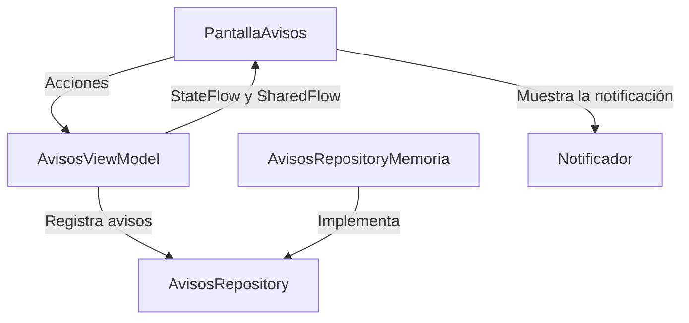
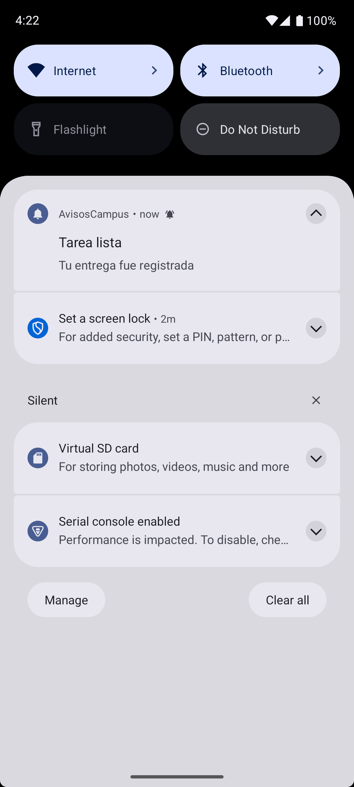
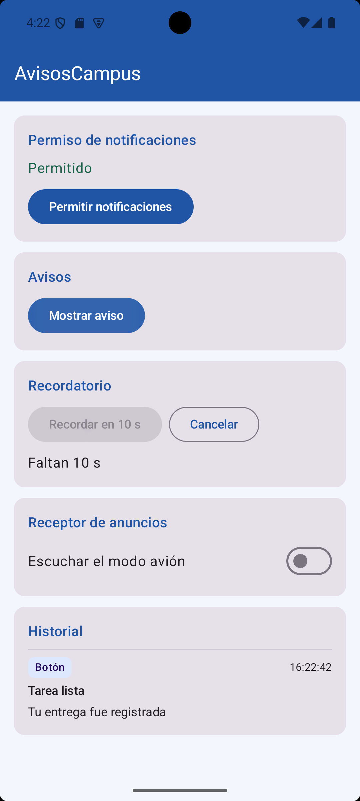
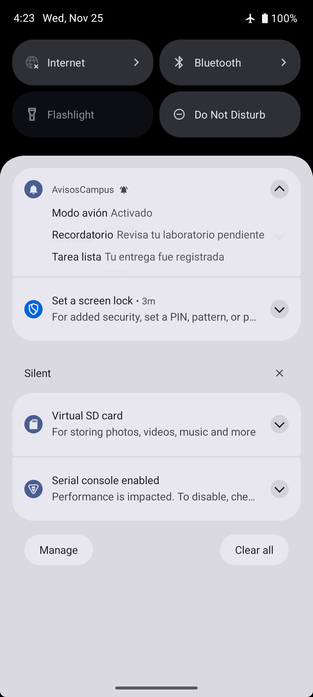
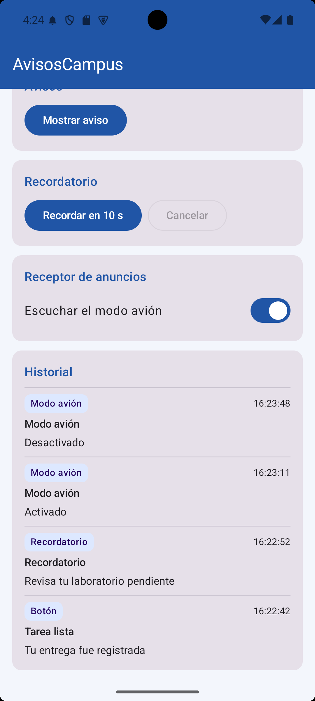
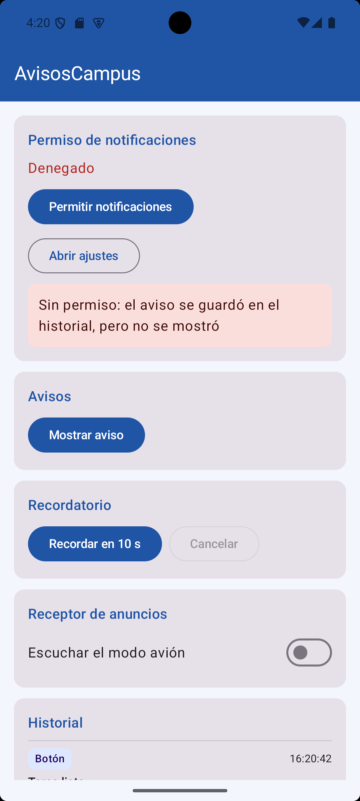

# AvisosCampus

App Android en Kotlin y Jetpack Compose. Muestra avisos locales, programa un recordatorio de 10 segundos y escucha el modo avión. Guarda los avisos en un historial en memoria.

Abre `Semana-15` en Android Studio. Usa un emulador Android 13 o superior para probar el permiso.

## Estructura de paquetes

| Paquete | Archivos |
| --- | --- |
| `com.tecsup.avisoscampus` | `AvisosApp.kt`, `MainActivity.kt` |
| `model` | `Modelos.kt` |
| `data` | `AvisosRepository.kt` |
| `notificacion` | `Notificador.kt` |
| `receiver` | `ModoAvionReceiver.kt` |
| `viewmodel` | `AvisosViewModel.kt`, `AvisosViewModelFactory.kt` |
| `ui` | `PantallaAvisos.kt`, `HistorialAvisos.kt` |
| `ui.theme` | `Theme.kt` |

## MVVM + Repository

## Capturas

Pruebas realizadas en un Pixel 7 con Android 15 (API 35).

| Notificación «Tarea lista» | Cuenta regresiva | Aviso de modo avión |
| --- | --- | --- |
|  |  |  |

| Historial | Permiso denegado |
| --- | --- |
|  |  |

## Para pensar

1. **¿Por qué necesita un canal y un permiso?** Desde Android 8, el canal agrupa los avisos y permite controlar cómo se muestran. Si falta, Android no publica la notificación. Desde Android 13, el permiso autoriza a la app a publicar avisos. Si se niega, el registro queda en el historial de la app.
2. **¿Por qué el ViewModel emite un evento?** Así puede decidir qué aviso generar y guardar el historial sin depender de Android. La pantalla recibe el evento y pasa su contexto al notificador.
3. **¿Qué pasa si repites un id?** La segunda publicación actualiza la notificación existente con ese id. Con ids distintos, pueden aparecer las dos.
4. **¿Por qué el receptor debe ser corto y por qué se quita?** `onReceive` corre normalmente en el hilo principal. Una tarea larga puede bloquearlo. Quitar el receptor al salir o apagar el switch evita entregas innecesarias y que la pantalla quede retenida.
5. **¿Cuándo usarías una local o una push?** Usaría una local para un temporizador o un cambio de modo avión. Usaría una push de Firebase para avisar de una nueva tarea registrada en un servidor.

## Desarrollo

Los commits muestran los cambios de cada paso de la guía.
